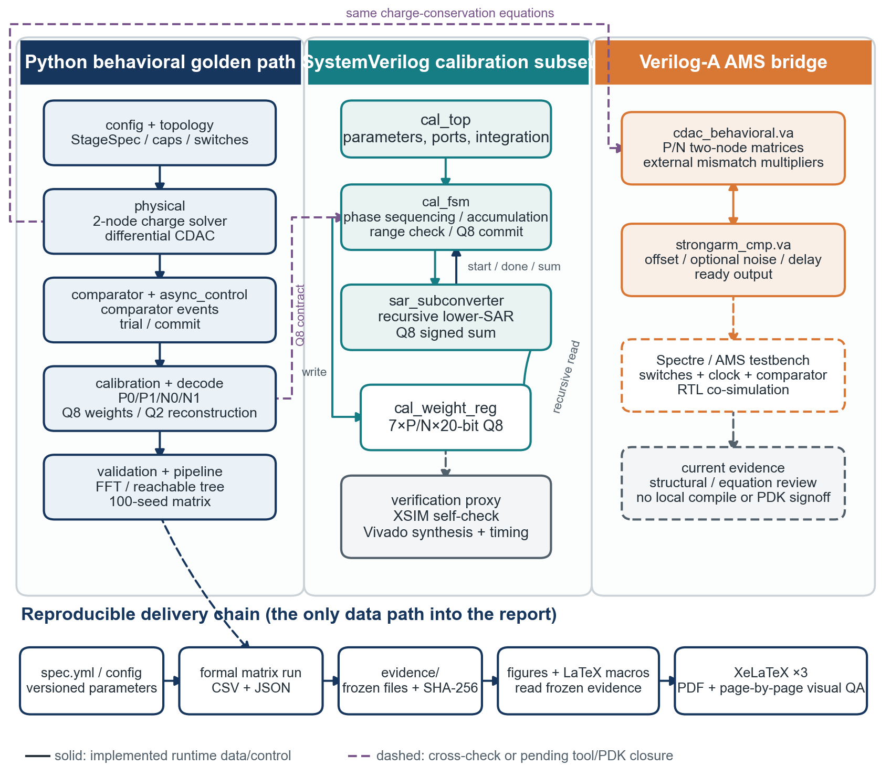
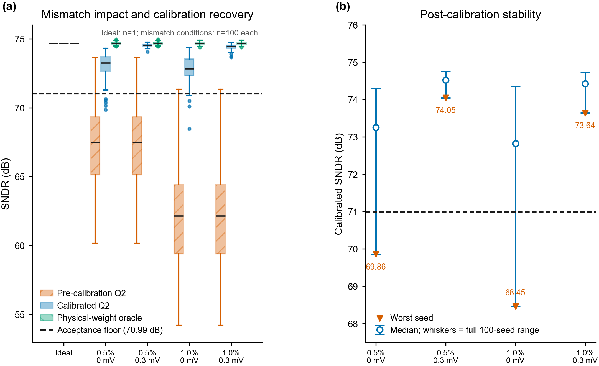
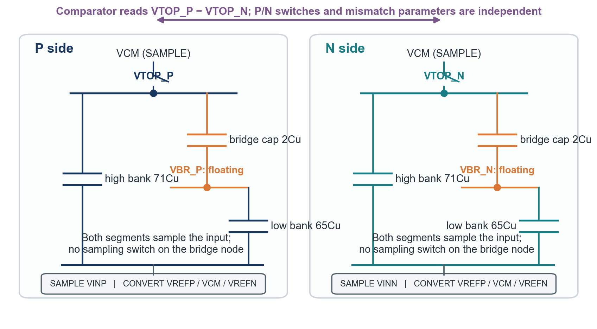
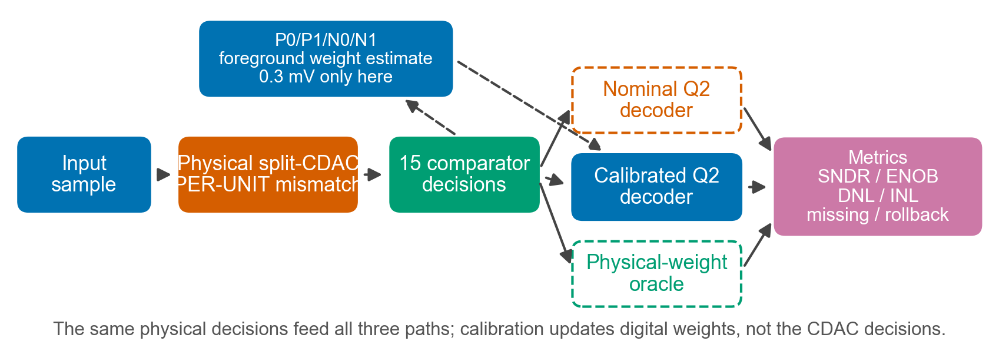
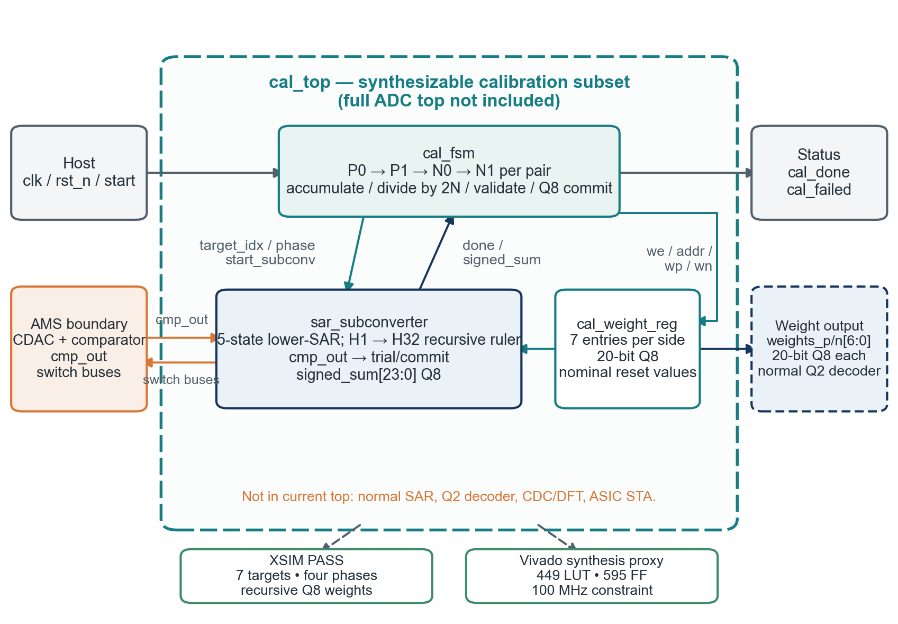

# Behavioral-modeling-of-12bit-calibrated-sar-adc

    [](VERSION) [](https://github.com/defineiocc02/Behavioral-modeling-of-12bit-calibrated-sar-adc/actions/workflows/python-model.yml)

> 12 位全差分 split-CDAC SAR ADC 的行为级建模、前景数字权重校准与可综合校准 RTL。

## 这是什么

本仓库回答一个主问题：**电容失配会怎样影响 SAR ADC，前景数字权重校准能否把整体性能稳住。**
噪声不是主线：正式场景使用独立 PER-UNIT 失配（每个单位电容单独抽样后再求和成物理电容组），
`0.3 mV RMS` 只注入 P0/P1/N0/N1 校准比较，用来解除 lower-SAR 重复测量的确定性量化锁定；
正常转换、FFT 与 SNDR 路径保持零噪声。

仓库给出从物理单位电容失配到电荷守恒 Python 模型、可综合 calibration/lower-SAR RTL、
Verilog-A CDAC/comparator 接口、冻结 Monte Carlo 证据与 LaTeX 报告的完整链路。



## 当前状态

| 项 | 值 |
|---|---|
| 阶段 | 行为级 + 数字实现验证完成；未流片 |
| 最近验证 | 2026-07-26 / v3.1.1：五组 100-seed 冻结矩阵、Python 回归、两组 XSIM、Vivado synthesis proxy |
| 关键指标 | ideal SNDR `74.643 dB`、ENOB `12.107 bit`；0.5% PER-UNIT + 0.3 mV 校准后 SNDR P50 `74.521 dB`（min `74.050 dB`）、动态/静态 `100/100`；综合 `449 LUT + 595 FF` |
| 结论边界 | 证据来自 100-seed Monte Carlo、静态可达码审计、Python 回归、XSIM 与 synthesis proxy；不是晶体管级 PVT、版图后仿或硅片 signoff |

### 结论先行

| 读者最关心的问题 | 当前答案 |
|---|---|
| 理想 ADC 链路正确吗？ | **正确**：SNDR `74.643 dB`，ENOB `12.107 bit`，0 missing code，0 backstep |
| 0.5% 单位电容失配能稳住吗？ | **能**：0.3 mV calibration-only 条件下，动态/静态/综合判定均为 `100/100` |
| 1.0% 双倍压力点怎样？ | 动态 `100/100`；静态 `98/100`，如实保留两个 INL 尾部失败样本 |
| 校准是否修改模拟 CDAC？ | **否**：物理 decisions 只运行一次；校准只更新 P/N 分侧数字权重 |
| 失配后的局部回退是否致命？ | nominal 最大 rollback 为 `1 LSB`，最大受影响输入宽度 `0.1620%`；作为诊断记录，不额外堆 LUT/CAM/clamp |
| RTL 可以综合和跑测试吗？ | **可以**：两组 XSIM 自检通过，综合为 `449 LUT + 595 FF` |
| 已经可以流片了吗？ | **不可以这样宣称**：setup proxy 通过，但 hold 尚有 4 个失败端点；PDK/PVT/PEX/晶体管级证据仍缺失 |

## 快速开始

### 依赖

- Python ≥ 3.10（PDF 渲染基线见 `requirements/report-render-py313.txt`）
- numpy ≥ 1.26；`.[dev]` 提供 pytest ≥ 8，`.[docs]` 提供 matplotlib ≥ 3.8
- 复现与综合脚本需要 PowerShell 7；XSIM/综合另需 Vivado

### 运行

```bash
git clone https://github.com/defineiocc02/Behavioral-modeling-of-12bit-calibrated-sar-adc.git
cd Behavioral-modeling-of-12bit-calibrated-sar-adc
python -m pip install -c requirements/report-render-py313.txt -e ".[dev,docs]"
python -m pytest
```

### 验证

```bash
python -m pytest                          # 发布基线：73 passed
pwsh ./scripts/reproduce.ps1 -BuildPdf    # 从冻结证据重建 docs/final_report.pdf
```

`reproduce.ps1 -BuildPdf` 不重跑 4096-point × 100-seed 矩阵，只读取
[`evidence/mismatch_matrix/`](evidence/mismatch_matrix/)；PDF/SVG/指标在 CI 中执行确定性复现门禁。
VM Spectre/Xcelium 的小型证据包位于
[`evidence/vm_sandbox/current_git_74e7366/`](evidence/vm_sandbox/current_git_74e7366/)，
复现入口会重新生成其确定性 manifest，但不会从 CI 连接私人 VM。

需要重跑完整五组矩阵时（PowerShell）：

```powershell
.\scripts\run_mismatch_matrix.ps1 -Seeds 100 -AveragePairs 128
python -m python_cal.validation.summarize_mismatch_matrix
python scripts\freeze_mismatch_evidence.py
python scripts\generate_report_figures.py --matrix-root evidence\mismatch_matrix
python scripts\generate_report_metrics.py
.\scripts\reproduce.ps1 -BuildPdf
```

重跑会更新数据；提交前必须核对 manifest、源码哈希、逐 seed 尾部失败和图稿，
不能只用一张平均曲线覆盖异常样本。

### 文档与证据索引

| 文档 | 用途 |
|---|---|
| [最终工程报告](docs/final_report.pdf) | 30 页 LaTeX 报告：底层方程、结果、RTL/VA、时序和边界 |
| [验证状态](docs/VALIDATION_STATUS.md) | 五组矩阵、逐 seed yield、静态失败样本与正式 verdict |
| [工程架构](docs/ENGINEERING_ARCHITECTURE.md) | Python/RTL/VA 职责、接口、数据流和实现边界 |
| [建模指南](docs/MODELING_GUIDE.md) | CDAC、采样、decision、Q8/Q2 和验证协议 |
| [硬件与 Verilog-A 移植说明](docs/HARDWARE_AND_VERILOGA_PORT.md) | RTL、AMS 接口与后续集成路径 |
| [本机与 VM 工作区地图](docs/VM_WORKSPACE_MAP.md) | Git/OA/仿真目录、VA 版本差异与最后运行状态 |
| [VM 远程操作与空间规范](docs/VM_REMOTE_OPERATIONS_STANDARD.md) | 保护路径、沙箱、配额、归档与交接标准 |
| [VM standalone 冻结证据](evidence/vm_sandbox/current_git_74e7366/) | Spectre/Xcelium 状态、TB、runner、日志摘要与 source hash |
| [图稿目录](docs/FIGURE_CATALOG.md) | 当前图、历史图与生成规则 |
| [版本管理](docs/VERSION_MANAGEMENT.md) | 活动、冻结、历史和临时产物边界 |
| [最终交付索引](FINAL_SUBMISSION.md) | 发布入口、复现命令和已知限制 |

## 目录结构

```text
src/python_cal/   Python 行为模型：topology/physical/comparator/async_control/
                  calibration/decode/validation/tests
rtl/              可综合 calibration/lower-SAR 子集与 XSIM testbench
va/               split-CDAC 与 StrongArm comparator 的 Verilog-A 接口
scripts/          矩阵、冻结、绘图、综合、时序与复现入口
evidence/         失配矩阵与 VM standalone 冻结证据、manifest/SHA-256
docs/             工程说明、图稿、LaTeX 源与最终 PDF
requirements/     PDF 渲染依赖锁定
```

## 设计与用法

### 失配模型

正式模型不是给整组电容平铺同一个相对误差的 PER-CAP，而是先对每个单位电容独立抽样，
再求和形成物理 capacitor group：

```text
Cunit,i = Cu × (1 + εi),       εi ~ Normal(0, σunit²)
Cgroup  = Σ Cunit,i
```

因此由 `N` 个单位电容组成的 group，其相对 sigma 自然约为 `σunit/√N`。
P/N 两侧独立抽样，2-Cu bridge 的两个 unit 也独立。

### 冻结验证矩阵



| 场景 | Pre SNDR P50 | Cal SNDR P50 / min | 动态 | 静态 | 缺码 | 定位 |
|---|---:|---:|---:|---:|---:|---|
| ideal, 0 mV | 74.643 | 74.643 / 74.643 dB | 1/1 | 1/1 | 0 | 理想基线 PASS |
| 0.5% PER-UNIT, 0 mV | 67.506 | 73.249 / 69.857 dB | 95/100 | 40/100 | 1 | 量化锁定隔离组 |
| **0.5% PER-UNIT, 0.3 mV** | 67.506 | **74.521 / 74.050 dB** | **100/100** | **100/100** | **0** | **nominal PASS** |
| 1.0% PER-UNIT, 0 mV | 62.154 | 72.825 / 68.455 dB | 96/100 | 27/100 | 1 | 压力隔离组 |
| 1.0% PER-UNIT, 0.3 mV | 62.154 | 74.424 / 73.641 dB | 100/100 | 98/100 | 0 | stress 尾部 FAIL |

五组使用同一批 100 个 seeds，动态、静态和综合判定逐 seed 保存于
[`evidence/mismatch_matrix/`](evidence/mismatch_matrix/)，不是只展示均值或挑选最好样本。
名义场景 calibrated decoder 相对 physical-weight oracle 的 SNDR gap P50/P95 仅为
`0.135/0.357 dB`。

### `0.3 mV` 不是 ADC 输入噪声指标

它的唯一定义是校准 P0/P1/N0/N1 比较时的输入等效高斯扰动：

```text
ncal ~ Normal(0, (0.3 mV RMS)²)
normal conversion noise = 0
```

零扰动隔离组暴露了重复 lower-SAR 测量的确定性量化锁定；0.3 mV 场景检查小扰动下平均权重
能否稳定收敛。项目没有额外 dither DAC，也没有把该扰动注入正常转换来虚构 SNDR 改善。

### CDAC 与比较决策

每个差分侧均采用整数单位电容：

```text
high segment : 32, 16, 8, 8, 4, 2, 1 Cu  = 71 Cu
bridge       : 2 Cu
low segment  : 32, 16, 8, 4, 2, 2, 1 Cu  = 65 Cu
total        :                                138 Cu / side
```



关键物理约束：

- P/N 两侧各有 14 个 physical bottom-plate groups；
- 正常采样时全部 high/low 电容参与输入采样，仅 `VTOP_P/VTOP_N` 在采样相位钳到 VCM；
- bridge node 是内部浮动节点，不增加 bridge-node sampling switch；
- 每次转换包含 14 个物理 trial/compare/commit，以及一个不增加电容的 comparator-only terminal decision；
- decoder 是普通 P/N 加权和，不包含 decision LUT、CAM、异常映射或单调钳位。

Python 与 Verilog-A 使用同一套两节点电荷守恒矩阵求解 top/bridge 电压，
避免把 bridge 简化成固定比例后再补经验权重。

### 前景校准协议

七个 high-segment 目标按以下顺序递归校准：

```text
H1 → H2 → H4 → H8-R → H8-A → H16 → H32
```

每个目标执行 P0/P1/N0/N1 四相测量：

```text
WP = mean(SP0 - SP1) / 2
WN = mean(SN1 - SN0) / 2
```

默认 128 pairs，共 `7 × 4 × 128 = 3584` 次 lower-SAR sub-conversions；每个目标完成后立即
截断到 Q8（与 `cal_weight_reg.sv` 的寄存器和算术右移一致），最终 ADC 输出使用 Q2 加权和。



公平性要求：每个 seed 只执行一次物理 conversion，并保存同一组 15-bit comparator decisions；
nominal、calibrated 与 physical-weight oracle 三路 decoder 随后读取完全相同的 decisions，
校准不会回头修改已经发生的 CDAC 比较结果。

FFT 固定为 4096 点、coherent bin 1019、phase `0.123 rad`、`-0.5 dBFS`、rectangular window；
每个 seed 都重新测量可用 VFS 并检查 clipping。

### 单调性：记录问题，不为诊断指标堆硬件

理想链路为 0 backstep。失配后冗余 decision words 的相邻可达区间可能发生局部次序交换，
nominal 场景 99/100 seeds 能观察到这种诊断现象，但最大 rollback 始终只有 `1 LSB`，
最大受影响输入宽度为 `0.1620%`，且 nominal dynamic、missing-code、DNL/INL 与综合验收仍为 `100/100`。

因此当前版本保留 backstep count、rollback 和区间宽度数据，却不为了把诊断数字归零而增加
LUT、排序器、CAM 或有状态 clamp。若未来应用明确要求 strict monotonicity，再把它升级成独立硬规格。

### 三层实现与证据边界



| 工程层 | 已完成 | 仍未完成/不能外推 |
|---|---|---|
| Python behavioral | 物理 CDAC、采样、转换、校准、三路 Q2 解码、FFT、静态审计 | 不是 transistor/PVT/silicon 结果 |
| Calibration RTL | `cal_top`、FSM、recursive lower-SAR、7×P/N×20-bit Q8 register；两组 XSIM PASS | 不包含完整 normal SAR、Q2 decoder、CDC/DFT、ASIC STA |
| Vivado proxy | 449 LUT、595 FF、0 DSP/BRAM；100 MHz setup WNS `+0.298 ns` | hold WHS `-0.147 ns`、4 个失败端点；342/125 IOB，raw top 不是可布局封装顶层 |
| Verilog-A | `cdac_behavioral.va` 与 `strongarm_cmp.va` 已在隔离 VM 沙箱通过 Spectre standalone smoke | 尚无 full-ADC AMS、目标 PDK、PVT 或 transistor replacement；CDAC 保留 4 条 `VACOMP-1116` |

## 已知限制

- 无晶体管级、PVT、PEX 与硅片数据：reference/switch、kickback、功耗均未覆盖，不能据此宣称可流片。
- Vivado 只是 synthesis proxy：hold 未收敛（4 个失败端点），raw top 不是可布局封装顶层，不能由此推算 ASIC 面积、功耗或良率。
- Calibration RTL 只覆盖校准与 lower-SAR 子集，不含完整 normal SAR、Q2 decoder、CDC/DFT 与 ASIC STA。
- Verilog-A 仅 standalone smoke，无 full-ADC AMS；CDAC 仍有 4 条 `VACOMP-1116`。
- `100/100` 只针对所列噪声、失配、输出精度与验收阈值，不等于制造良率 100%，静态通过也不包含严格单调性保证。
- 回归基线 `73 passed` 为 v3.1.1 记录；CI 在 `main` 上尚无运行记录（最近一次为 2026-07-26），
  badge 在产生首次 `main` run 前会显示 no status。

### 明确不做

不添加 calibration sub-DAC、auxiliary comparator 或额外 dither DAC；不升级成 512-pair 默认校准；
不用 decision LUT/CAM/异常表掩盖失配结果；不为 1-LSB diagnostic backstep 加有状态 clamp，
也不在 bridge node 增加 sampling clamp；不从 FPGA proxy 推算 ASIC 面积、功耗、良率或流片状态；
不把 calibration-only 0.3 mV 扰动包装成正常 ADC 噪声性能。保留 Q2、15th terminal、P/N 分侧 Q8 权重
和每目标即时写回，是因为它们有直接的物理、性能或 RTL 一致性依据，而不是为了堆功能。

## English summary

This repository studies the impact of **independent per-unit capacitor mismatch** on a 12-bit
differential split-CDAC SAR ADC and verifies whether foreground digital weight calibration keeps
the converter within its behavioral targets. The primary 0.5% unit-mismatch case passes 100/100
dynamic and static seeds after calibration. The 0.3 mV RMS term is injected during calibration
comparisons only; normal ADC conversions remain noiseless.

The repository contains a charge-conservation Python model, synthesizable calibration/lower-SAR
RTL, Verilog-A CDAC/comparator interfaces, frozen Monte Carlo evidence, deterministic figures, and
a visually reviewed LaTeX report. These are behavioral and digital implementation results—not
transistor-level, post-layout, or silicon signoff.

## 相关仓库

暂无直接关联的仓库。

## 许可

[MIT](LICENSE)
